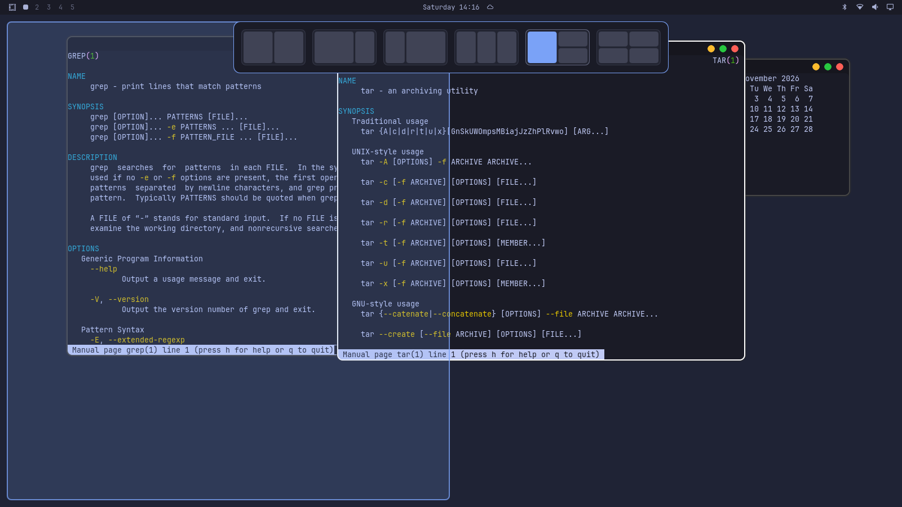
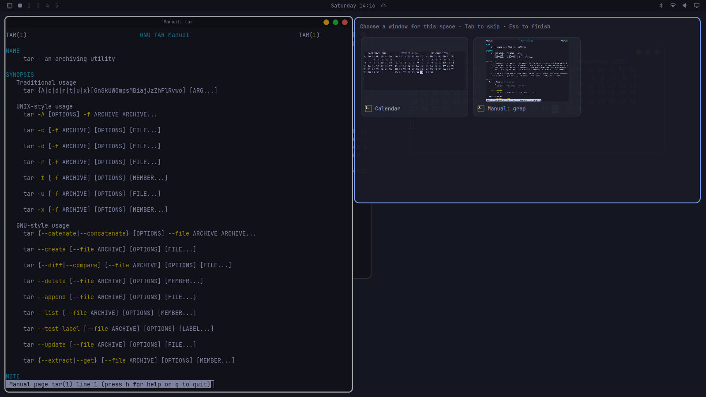
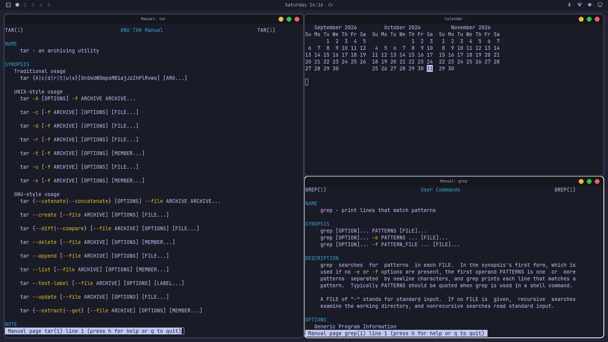

# Snap Layouts for Omarchy

[-ready-2ea44f)](#compatibility)
[](LICENSE)


Drag a window to the top of the screen, drop it on the layout you want, then choose which windows fill the other spaces. A snap layout picker in the style of Windows 11, built as a shell plugin for [Omarchy](https://omarchy.org). **Omarchy 4 (Quattro) ready.**



The screenshots show the plugin running in Omarchy's real shell.

## Features

- **Drag to snap:** drag a floating window to the top of a screen and the picker appears. A preview shows where the window will land.
- **Six layouts:** two halves, two-thirds and one-third (either way round), three columns, one half and two quarters, and four quarters.
- **Snap assist:** after the first window lands, pick windows for the remaining spaces from live thumbnails. Minimized windows and windows on other workspaces are offered too.
- **Keyboard shortcut:** open the picker for the focused window, including tiled windows, which become floating when snapped.
- **Fits your screen:** zones stay clear of the top bar and dock on each monitor.
- **Follows your theme:** colours and fonts come from your Omarchy theme.

## Screenshots

| Snap assist | Finished layout |
|---|---|
|  |  |

## Install

Plugins run as unsandboxed code inside your shell, so read the code first if you don't know the source. Then run:

```sh
omarchy plugin add https://github.com/n0rthstar88/omarchy-snap-layouts --enable
```

The first time it loads, a prompt asks whether to keep drag-to-snap on.

To open the picker with Super+Z as well, add this line to `~/.config/hypr/bindings.lua`:

```lua
o.bind("SUPER + Z", "Snap layouts", hl.dsp.event("io.github.n0rthstar88.snap-layouts:toggle"))
```

## Use

**Drag:** move a floating window with Super+drag, or with a title bar if your windows have one. Take the pointer to the top of the screen, move onto a zone in the picker, and let go. Dropping anywhere else, or dragging well below the picker, cancels it.

**Shortcut:** press Super+Z and click a zone. Press Esc or click outside the picker to cancel.

**Snap assist:** click a window to put it in the highlighted space. Tab skips that space, and Esc finishes early. It doesn't appear if there are no other windows or no spaces left.

Drag-to-snap only reacts to windows that are already floating, so on a default tiling setup, float the window first or use the shortcut.

### Title bars (optional)

Omarchy's windows have no title bars by default. If you want to grab windows by a header, with close, maximize and minimize buttons as in the screenshots, see [Title bars](extras/hyprbars/README.md). The plugin notices when the title bar plugin is loaded and keeps each header inside its zone.

## Commands

```sh
omarchy-shell snaplayouts toggle            # open or close the picker
omarchy-shell snaplayouts close             # close it
omarchy-shell snaplayouts choose 0 1        # with the picker open: layout 0, zone 1 (right half)
omarchy-shell snaplayouts drag on           # also: off, status
```

Layouts and zones count from 0, left to right as shown in the picker. The drag-to-snap choice is saved in `~/.config/omarchy/shell.json`.

## Configuration

These values are at the top of `SnapLayouts.qml`. Hyprland's Lua config doesn't report them to plugins, so change them to match your setup if yours differ, then run `omarchy restart shell`.

| Setting | Default | Meaning |
|---|---|---|
| `outerGap` | `10` | Space between windows and the screen edge |
| `innerGap` | `0` | Space between snapped windows |
| `borderSize` | `2` | Must match Hyprland's `general.border_size` |
| `titleBarHeight` | `24` | Must match hyprbars' `bar_height`, if you use it |
| `dragTriggerDistance` | `30` | How close to the top the pointer must get to open the picker |
| `layouts` | six layouts | Zones as `[x, y, width, height]` fractions of the screen |

Local edits stop `omarchy plugin update` from updating the plugin until you undo them.

## Compatibility

Built and tested on **Omarchy 4.0.6 (Quattro)** with Hyprland 0.56.2 and Quickshell 0.3.2. It uses Omarchy's shell plugin system and Hyprland's Lua config, so older Omarchy releases and other desktops won't work.

Testing covered dragging by title bar and by a Hyprland mouse bind, snap assist, the picker commands, turning drag-to-snap off, and snapping a tiled window. Those checks ran on a single screen. Zones are worked out per monitor, but multi-monitor, scaled and rotated setups weren't part of them.

## Troubleshooting

- **The picker doesn't appear when dragging:** check `omarchy-shell snaplayouts drag status` says `on`, that the window is floating, and that the pointer reaches the top 30 pixels of the screen.
- **Dragging a title bar does nothing, but Super+drag works:** the title bar plugin wasn't built with [the drag events](extras/hyprbars/README.md). `extras/hyprbars/rebuild-hyprbars.sh` adds them and warns if it can't.
- **Windows overlap or leave gaps:** set `borderSize` to match your Hyprland border.
- **`Target not found` from `omarchy-shell`:** the plugin isn't running. Check `omarchy plugin list`, then try `omarchy restart shell`.

## Uninstall

```sh
omarchy plugin remove io.github.n0rthstar88.snap-layouts
```

Then delete the Super+Z line from `bindings.lua` if you added it. The plugin's mouse binds go away the next time Hyprland reloads its config.

## Contributing and security

See [CONTRIBUTING.md](CONTRIBUTING.md) and [SECURITY.md](SECURITY.md).

## License

[MIT](LICENSE). The optional title bar script builds BSD-licensed code from hyprland-plugins; see [THIRD_PARTY_NOTICES.md](THIRD_PARTY_NOTICES.md).

This is an independent project. It isn't affiliated with or endorsed by Microsoft, Omarchy or the Hyprland project. Windows is a trademark of Microsoft Corporation, named here only to describe the style of the feature.
